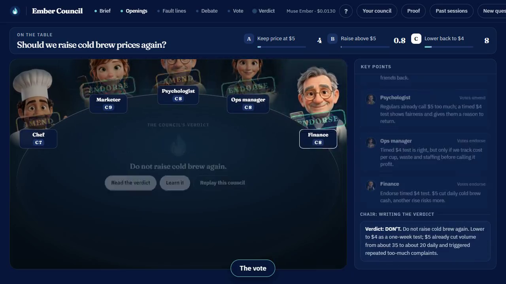
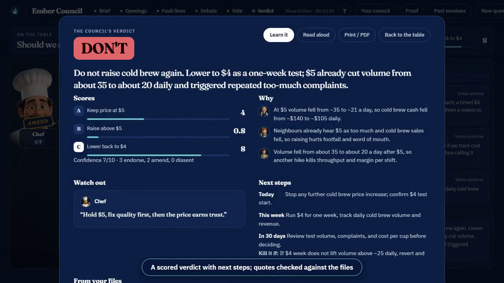

# Ember Council

**Your own board of advisors for a small business: ask a real question, watch them debate it, and get a clear answer based on your own files.**


▶ **Watch the 1-minute demo video:** [MP4](demo/ember_council_demo.mp4) · [WebM](demo/ember_council_demo.webm)

---

## What is it, in plain words?

A café owner has a decision to make, like *"Should we raise cold brew prices again?"* Usually they guess, or ask a friend.

Ember Council gives them a table of AI advisors instead: a chef, a marketer, a customer psychologist, an operations manager and a finance advisor. Each advisor reads the business's own files (price list, sales, reviews, customer emails), says what they think, argues with the others, and votes. The owner gets:

- a clear **answer** (do it / don't do it / try this instead) with a score,
- the **reasons**, each one pointing to the exact line in their files,
- **next steps** for today, this week and the next month,
- a **10-minute lesson** that teaches them how to use AI for this kind of decision on their own.

One full council costs about **one cent**. It runs on Meta's **Muse Ember** model through OpenRouter, or on a free local model on your own computer.

> The advisors are AI roles, not real people. The business in the demo (Bluebird Coffee Roasters) is made-up sample data.

## How it works, step by step

### 1. Ask your question
Type or say your question. Pick one of the examples or write your own.


### 2. Choose your advisors
Pick your industry and switch advisors on or off. Rename them, change what they focus on, or add your own (an investor, a bank lender, a market analyst...).


### 3. Watch them debate
Each advisor speaks in turn, quoting your files. Then they push back on each other.


### 4. They vote
Every advisor votes on the options.



### 5. Get the verdict
A clear answer, a score for each option, the reasons, the risks, and next steps. Every quote is checked against your files.



### 6. Learn it
The decision turns into a short lesson, with a ready-to-copy prompt you can reuse with any AI tool. You learn AI by doing your real work.


### 7. See what it cost
The **Proof** page lists every AI call: its ID, how many words (tokens) it used, and what it cost. This whole demo cost about $0.013.


## Other things it can do

- **Bring in a meeting:** paste or upload a transcript from Zoom, Teams, Google Meet, Otter or Fireflies (`.txt`, `.vtt`, `.srt`, `.md`). Fix any mistakes, and the advisors can quote it like any other file.
- **Voice:** ask your question with the microphone (works best in Chrome or Edge).
- **History:** every council is saved, and you can replay it from **Past sessions**.
- **Any AI model:** Muse Ember via OpenRouter (default), Meta's own API, or a free local model (Meta Llama on Ollama) that runs on your computer with no internet.

## Try it yourself

You only need Python. Nothing to install.

```
git clone https://github.com/managesg/ember-desk
cd ember-desk
python server.py
```

Open http://127.0.0.1:8000. The demo questions are saved, so they replay **for free** without any key. To ask new questions, set your OpenRouter key first: `set OPENROUTER_API_KEY=...` (Windows) or `export OPENROUTER_API_KEY=...` (Mac/Linux).

**Run it free and offline with a local model:**

```
ollama pull llama3.2
set LLM_BASE_URL=http://localhost:11434/v1
set LLM_MODEL=llama3.2
set LLM_API_KEY=ollama
python server.py
```

LM Studio and llama.cpp work the same way. You can also switch engines in the app under **Your council → Engine**.

---

## Technical details

<details>
<summary>How it is built</summary>

- One Python file (`server.py`, standard library only) plus a static front end in `public/`. The API key stays on the server and is never logged.
- All business files are packed into each call with line numbers, so every claim can cite `file Lx-y`. Citations are checked against the real lines.
- Flow: the Chair proposes seats → openings → fault lines → rebuttals → draft → votes → verdict → Learn it. Each advisor turn is one short call.
- Responses are cached in `cache/`, so saved questions replay at $0. A budget guard stops calls once logged spend reaches `BUDGET_CAP`.
- History: `data/history/<session>.json` (question, advisors, every turn with checked citations, votes, verdict, engine, cost). One summary line per session in `logs/council_log.jsonl`.
- Meeting import: `POST /api/transcript {"title": "...", "text": "..."}` lets recorders or automations (Zapier, Make) send transcripts. Timestamps are stripped, speaker names kept.
- Engines: OpenRouter `meta/muse-ember` (default); Meta API `https://api.meta.ai/v1` with `muse-ember-1.0` (needs a pay-as-you-go `META_API_KEY`); any OpenAI-compatible endpoint via `LLM_BASE_URL` / `LLM_MODEL` / `LLM_API_KEY`.
- `python server.py --selftest` runs quick checks. `python record.py` re-records the demo video from the cache with Playwright.
</details>

<details>
<summary>Cost proof (OpenRouter × Meta "$1 Challenge")</summary>

| Item | Value |
|---|---|
| Model | `meta/muse-ember` via OpenRouter |
| Per-call log | `proof/council_log.jsonl`: generation id, model, provider, tokens, cost, latency |
| Build + test spend | $0.0131 over 22 live calls (~$0.0006 per call) |
| One full council | about $0.011 (18 calls) plus ~$0.0006 for the Chair; Learn it ~$0.0008; a saved replay is $0 |
| Earlier Ember Desk version | $0.0110, `proof/openrouter_log.jsonl` |

Muse Ember is a reasoning model: with too small a `max_tokens`, the hidden reasoning used the whole budget and the answer came back empty. Setting `reasoning.effort=low` with more output tokens fixed it, and that wasted spend is included above. OpenRouter's key-level usage lags behind per-call `usage.cost`, so the per-call log is the authoritative number.
</details>

## Credits

- Table layout adapted from [Roast Room](https://github.com/nateherkai/roast-room) (MIT, © 2026 AI Automation Society). See `LICENSE` and `NOTICE`.
- Advisor portraits are original and show no real people. All business data is sample data (`gen_data.py`).
- Built by [SeaBridgeAI](https://www.seabridge.ai/) for the OpenRouter × Meta Build Day, November 2026.
