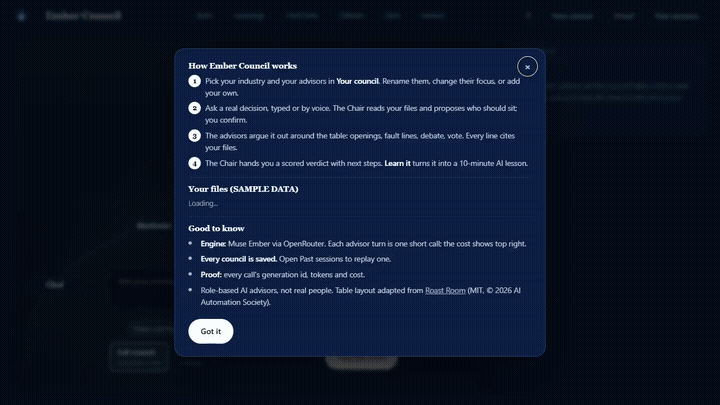
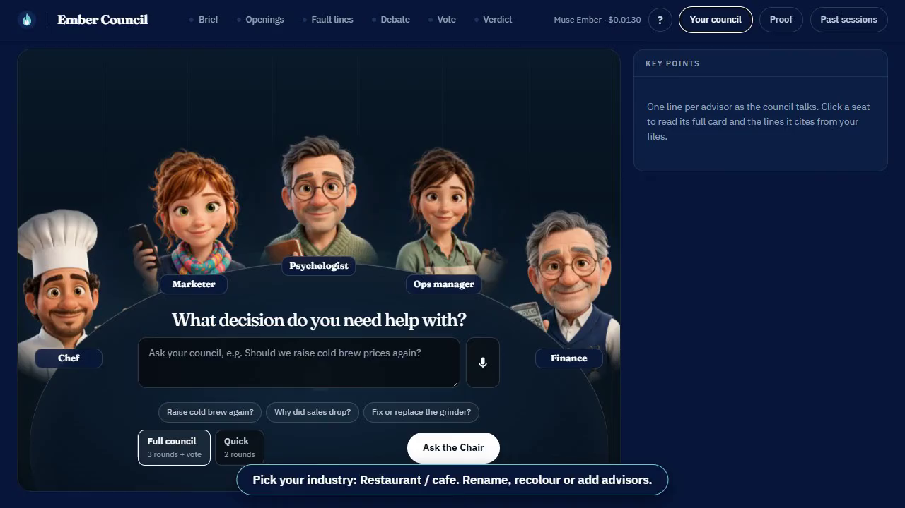
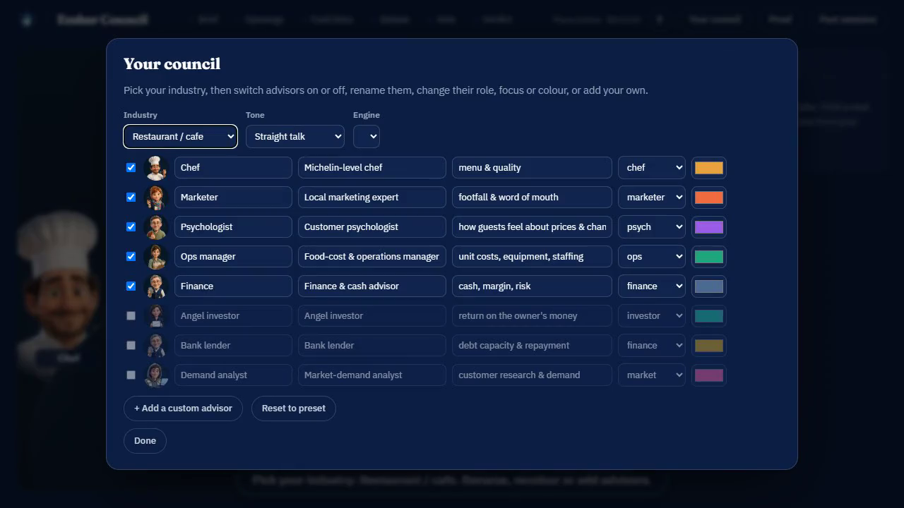
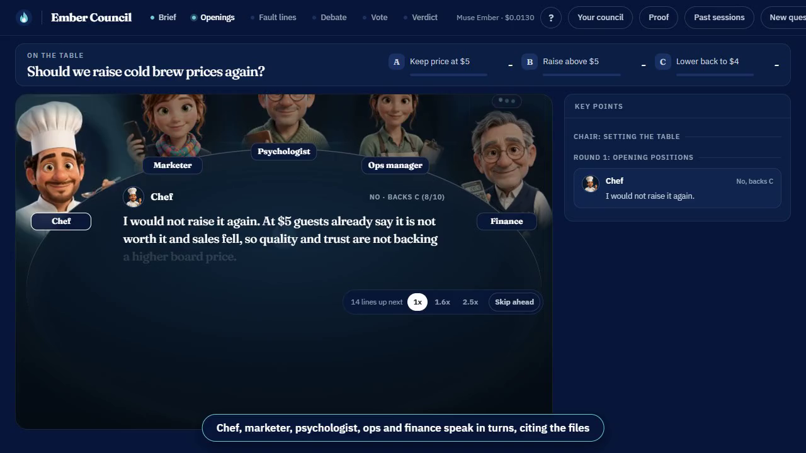
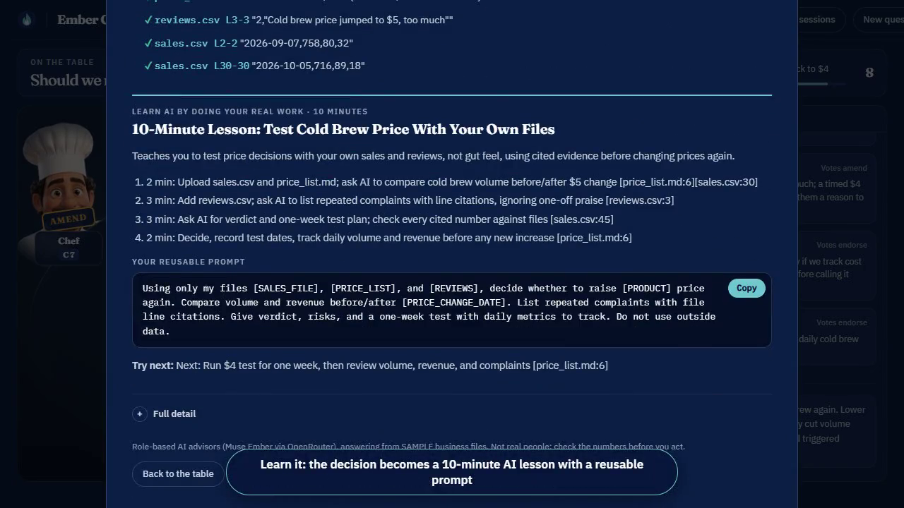
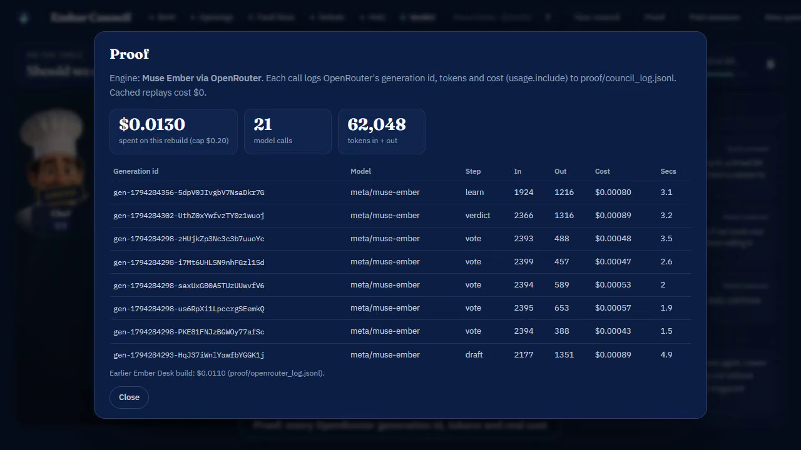
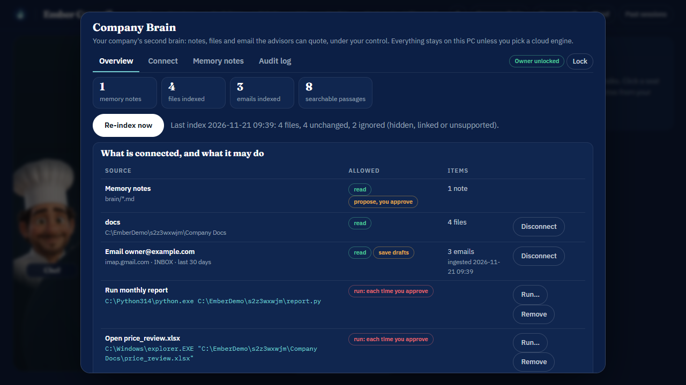
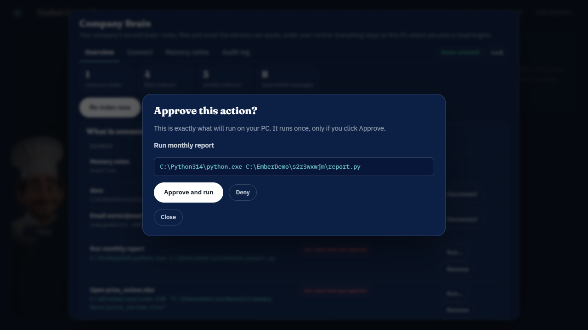
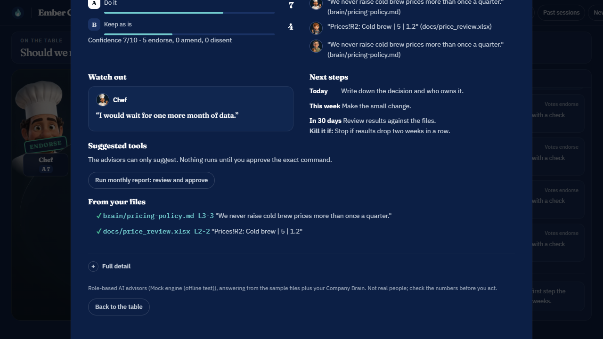

# Ember Council

**Your own board of advisors for a small business: ask a real question, watch them debate it, and get a clear answer based on your own files.**



▶ **Watch the 1-minute demo video:** [MP4](demo/ember_council_demo.mp4) · [WebM](demo/ember_council_demo.webm)

---

## What is it, in plain words?

A café owner has a decision to make, like *"Should we raise cold brew prices again?"* Usually they guess, or ask a friend.

Ember Council gives them a table of AI advisors instead: a chef, a marketer, a customer psychologist, an operations manager and a finance advisor. Each advisor reads the business's own files (price list, sales, reviews, customer emails), says what they think, argues with the others, and votes. The owner gets:

- a clear **answer** (do it / don't do it / try this instead) with a score,
- the **reasons**, each one pointing to the exact line in their files,
- **next steps** for today, this week and the next month,
- a **10-minute lesson** that teaches them how to use AI for this kind of decision on their own.

One full council costs about **one cent**. It runs on Meta's **Muse Ember** model through OpenRouter, or on a free local model on your own computer.

> The advisors are AI roles, not real people. The business in the demo (Bluebird Coffee Roasters) is made-up sample data.

## How it works, step by step

### 1. Ask your question
Type or say your question. Pick one of the examples or write your own.



### 2. Choose your advisors
Pick your industry and switch advisors on or off. Rename them, change what they focus on, or add your own (an investor, a bank lender, a market analyst...).



### 3. Watch them debate
Each advisor speaks in turn, quoting your files. Then they push back on each other.



### 4. They vote
Every advisor votes on the options.


### 5. Get the verdict
A clear answer, a score for each option, the reasons, the risks, and next steps. Every quote is checked against your files.


### 6. Learn it
The decision turns into a short lesson, with a ready-to-copy prompt you can reuse with any AI tool. You learn AI by doing your real work.



### 7. See what it cost
The **Proof** page lists every AI call: its ID, how many words (tokens) it used, and what it cost. This whole demo cost about $0.013.



## Other things it can do

- **Bring in a meeting:** paste or upload a transcript from Zoom, Teams, Google Meet, Otter or Fireflies (`.txt`, `.vtt`, `.srt`, `.md`). Fix any mistakes, and the advisors can quote it like any other file.
- **Voice:** ask your question with the microphone (works best in Chrome or Edge).
- **History:** every council is saved, and you can replay it from **Past sessions**.
- **Any AI model:** Muse Ember via OpenRouter (default), Meta's own API, or a free local model (Meta Llama on Ollama) that runs on your computer with no internet.

## Company Brain: let the advisors read your own files, email and tools

Out of the box the advisors read a made-up coffee shop. **Company Brain** lets a small company point them at its *real* knowledge, safely and under the owner's control. It is optional. If you never open it, nothing changes.

- **Notes it remembers.** Plain Markdown files in the `brain/` folder: decisions, who does what, prices, policies. After a council the advisors can *propose* a new note. You read it and approve or reject it. Nothing is remembered without your OK.
- **Folders you choose.** Add a folder and Ember Council reads the `.txt`, `.md`, `.csv`, `.docx` and `.xlsx` files in it (and `.pdf` if you install the optional `pypdf`). Everything else on your computer is ignored.
- **Email, read only.** Connect Gmail, Google Workspace, Microsoft 365 or any IMAP mailbox with an app password. It reads the last few weeks. An optional *draft only* mode can save a reply you wrote into your Drafts folder. **It can never send an email.** There is no send code in the app at all.
- **A few desktop tools.** You name an action (for example "Open sales.xlsx in Excel" or "Run monthly_report.py") with one fixed command. Advisors can *suggest* it. It only runs after you click Approve on the exact command.
- **Quotes you can check.** Answers cite where they came from, like `brain/pricing-policy.md L3`, `docs/Supplier agreement.docx L2` or `email:2026-11-16 Invoice 4471 due Friday L6`, and each quote is checked against the real line.



### Set it up in about five minutes

1. **Install and start.** Windows: double-click `start.bat`. Mac or Linux: run `bash install.sh`. It checks Python 3.10+, offers the optional extras, spots Ollama if you have it, starts the app and opens your browser.
2. **Open Company Brain** (top right) and choose an owner PIN. It is stored scrambled (PBKDF2), and every change needs it. Prefer a token? Set `EMBER_ADMIN_TOKEN` before starting and use that instead. The app only answers to `127.0.0.1` / `localhost`. To post meeting transcripts through a tunnel (Zapier, Make, ngrok), start it with `EMBER_ALLOWED_HOSTS=your-tunnel-name`.
3. **Connect a folder.** Type its path, for example `C:\Company\Documents`. You see how many files were indexed. Press *Re-index now* after you add files. *Disconnect* removes the folder and forgets its files in one click.
4. **Connect email (optional).** Use an **app password**, not your normal password. For Gmail or Google Workspace turn on 2-step verification, then create an app password. Pick *Read only* or *Read + save drafts*, press *Connect*, then *Ingest recent email*. Many Microsoft 365 companies block app passwords for IMAP. If yours does, wait for sign-in with OAuth, which is the next thing planned.
5. **Add tools (optional).** Name the action and give the command, or point at a file to open with its normal app. Shells such as `cmd`, `powershell` and `bash`, and `.bat` / `.ps1` files, are refused on purpose.
6. **Ask a question.** The advisors now see the few passages that best match it, next to the sample files.



Every run of a tool shows the exact command and waits for your click.



The verdict cites your note and your spreadsheet, and suggests a tool without running it. (This screenshot uses the built-in offline test engine, so the wording is canned; the sources are real.)

### What stays on your computer

| What | Where |
|---|---|
| Your notes | `brain/*.md` (plain text you can open and edit) |
| The search index | `brain/index.sqlite` (SQLite, on this PC) |
| Email passwords | A restricted file in your user profile (`%APPDATA%\EmberCouncil` on Windows, `~/.config/ember-council` elsewhere), or your system keyring if `keyring` is installed. Never in this folder, never in logs, never sent to the model. |
| The activity log | `logs/brain_audit.jsonl`: every source added, index run, email read, draft saved and action approved or run. It records *that* it happened, never the contents. |

All of this is ignored by git, so it is not committed by accident. One thing to know: saved past sessions (`data/history/`) keep the lines the advisors quoted, and `logs/council_log.jsonl` keeps each question, so treat both as company data. Answers built after Company Brain is set up are cached in `brain/cache/`, which git also ignores.

### Choose where the thinking happens

- **Local engine (recommended for private or regulated data).** Run a model on your own PC with Ollama or LM Studio. Nothing leaves the computer. Pick it in *Company Brain -> Engine and privacy*.
- **Muse Ember through OpenRouter.** Only the question and the handful of retrieved passages are sent, never your whole drive. Before sending, emails, phone numbers and card or IBAN-like numbers are replaced with `[email]`, `[phone]`, `[card]` and `[iban]`. You can turn that off. When Company Brain is in use the request also asks OpenRouter to use only providers that do not store prompts (`provider: {"data_collection": "deny"}`). If no provider qualifies, the request fails instead of leaking, and you can switch that off in the same panel. (Redaction is a safety net, not a guarantee: odd formats can slip through, so use a local engine for the most sensitive material.)

### What it will never do

- **Send email.** No SMTP, no send button. The most it does is save a draft you wrote into your Drafts folder, and only in draft mode.
- **Run a command you have not approved.** Advisors can only suggest. Each run needs your click on the exact command, and the command cannot be changed in between.
- **Read outside the folders you added.** Paths with `..`, links that point out of the folder, hidden and system files, and files with names like `passwords` or `secret` are skipped.
- **Change or delete your mail or files.** Mail is opened read-only, and the folders are only read.

### Ideas it grew from

Company Brain was designed after reading these open-source projects. No code was taken from them; it is written from scratch in the same plain standard-library style as the rest of Ember Council.

- [henrydaum/second-brain](https://github.com/henrydaum/second-brain): a local agent "operating system" with folder indexing and a Gmail bundle.
- [maks-mk/kgbagent](https://github.com/maks-mk/kgbagent): a single-exe desktop agent with MCP tools and human-in-the-loop approvals.
- [elie222/inbox-zero](https://github.com/elie222/inbox-zero): email triage and drafted replies.
- [itechmeat/open-second-brain](https://github.com/itechmeat/open-second-brain): company memory as plain Markdown plus search.
- [safhac/privemail](https://github.com/safhac/privemail) and [AnshMNSoni/email-agent](https://github.com/AnshMNSoni/email-agent): fully local email with Ollama.

## Try it yourself

You only need Python (3.10 or newer). Nothing to install. For a guided start with Company Brain use `start.bat` (Windows) or `bash install.sh` (Mac/Linux).

```
git clone https://github.com/managesg/ember-desk
cd ember-desk
python server.py
```

Open http://127.0.0.1:8000. The demo questions are saved, so they replay **for free** without any key. To ask new questions, set your OpenRouter key first: `set OPENROUTER_API_KEY=...` (Windows) or `export OPENROUTER_API_KEY=...` (Mac/Linux).

**Run it free and offline with a local model:**

```
ollama pull llama3.2
set LLM_BASE_URL=http://localhost:11434/v1
set LLM_MODEL=llama3.2
set LLM_API_KEY=ollama
python server.py
```

LM Studio and llama.cpp work the same way. You can also switch engines in the app under **Your council → Engine**.

---

## Technical details

<details>
<summary>How it is built</summary>

- `server.py` and `brain.py` (both standard library only) plus a static front end in `public/`. The API key stays on the server and is never logged.
- All business files are packed into each call with line numbers, so every claim can cite `file Lx-y`. Citations are checked against the real lines.
- Flow: the Chair proposes seats → openings → fault lines → rebuttals → draft → votes → verdict → Learn it. Each advisor turn is one short call.
- Responses are cached in `cache/`, so saved questions replay at $0. A budget guard stops calls once logged spend reaches `BUDGET_CAP`.
- History: `data/history/<session>.json` (question, advisors, every turn with checked citations, votes, verdict, engine, cost). One summary line per session in `logs/council_log.jsonl`.
- Meeting import: `POST /api/transcript {"title": "...", "text": "..."}` lets recorders or automations (Zapier, Make) send transcripts. Timestamps are stripped, speaker names kept.
- Engines: OpenRouter `meta/muse-ember` (default); Meta API `https://api.meta.ai/v1` with `muse-ember-1.0` (needs a pay-as-you-go `META_API_KEY`); any OpenAI-compatible endpoint via `LLM_BASE_URL` / `LLM_MODEL` / `LLM_API_KEY`.
- Company Brain (`brain.py`): notes in `brain/*.md`; a SQLite FTS5 index (`brain/index.sqlite`, porter tokenizer, BM25) over notes, allowlisted files (docx and xlsx parsed with `zipfile` + `xml.etree`) and email read with `imaplib` (`select(readonly=True)`, `BODY.PEEK[]`). The top 6 passages for the question are appended after the sample files in the same `N| line` format, so citations stay `file Lx-y`. Owner routes live under `/api/brain/` and need the PIN token (PBKDF2-HMAC-SHA256, 310,000 rounds) or `EMBER_ADMIN_TOKEN`. The server also refuses unexpected `Host` headers and cross-site POSTs.
- Retrieved text is marked as data, not instructions, and only the owner's own actions can be run. If the folders hold untrusted documents or email, a hostile message could still try to mislead an advisor, so read the cited lines before you act.
- Answers built on company data are cached in `brain/cache/`, not the tracked `cache/`. Saved demo replays keep their exact cache keys.
- `LLM_MOCK=1` starts a deterministic offline engine (`mock_llm.py`), used by the tests and the Company Brain screenshots. `python tests/shots_brain.py` retakes them against a mocked mailbox and temp folders.
- `python server.py --selftest` runs the original quick checks plus the 20 Company Brain tests in `tests/` (path allowlist and traversal, docx/xlsx parsing, FTS retrieval with citations, draft-only IMAP that never sends, secrets never in logs, action approval, redaction, PIN hashing, replay cache keys unchanged). `python record.py` re-records the demo video from the cache with Playwright.
</details>

<details>
<summary>Cost proof (OpenRouter × Meta "$1 Challenge")</summary>

| Item | Value |
|---|---|
| Model | `meta/muse-ember` via OpenRouter |
| Per-call log | `proof/council_log.jsonl`: generation id, model, provider, tokens, cost, latency |
| Build + test spend | $0.0131 over 22 live calls (~$0.0006 per call) |
| One full council | about $0.011 (18 calls) plus ~$0.0006 for the Chair; Learn it ~$0.0008; a saved replay is $0 |
| Earlier Ember Desk version | $0.0110, `proof/openrouter_log.jsonl` |

Muse Ember is a reasoning model: with too small a `max_tokens`, the hidden reasoning used the whole budget and the answer came back empty. Setting `reasoning.effort=low` with more output tokens fixed it, and that wasted spend is included above. OpenRouter's key-level usage lags behind per-call `usage.cost`, so the per-call log is the authoritative number.
</details>

## Credits

- Table layout adapted from [Roast Room](https://github.com/nateherkai/roast-room) (MIT, © 2026 AI Automation Society). See `LICENSE` and `NOTICE`.
- Advisor portraits are original and show no real people. All business data is sample data (`gen_data.py`).
- Company Brain ideas: see *Ideas it grew from* above (no code taken).
- Built by [SeaBridgeAI](https://www.seabridge.ai/) for the OpenRouter × Meta Build Day, November 2026.
